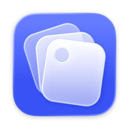

<h1 align="center">BetterConnect</h1>

A faster App Store Connect for your Mac: versions, builds, TestFlight, reviews, pricing, offer codes and sales, across all your accounts.

<a href="https://github.com/IndieGoodies/BetterConnect/releases/latest/download/BetterConnect.dmg"><b>Download BetterConnect</b></a>

## Requirements

- macOS 26 or later
- Apple silicon or Intel Mac
- An App Store Connect API key

## Updates

BetterConnect checks for updates on its own. You can also download the latest version from
[Releases](https://github.com/IndieGoodies/BetterConnect/releases/latest).
